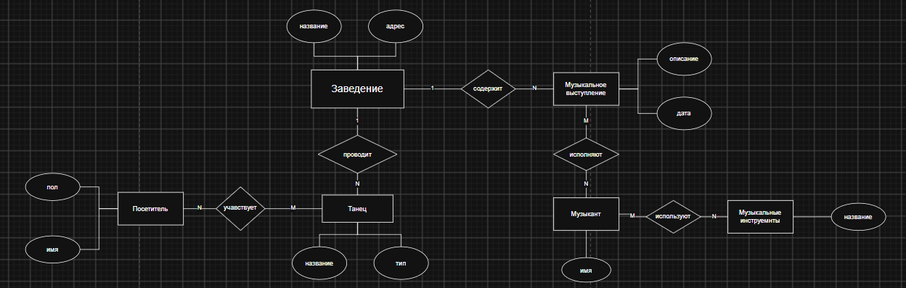

# 🗄️ Базы данных · ИТМО

**Стек:** PostgreSQL · SQL · draw.io

*Лабораторная №1: модель предметной области «Танцевальное мероприятие».*

Лабораторные работы по проектированию реляционных баз данных и PostgreSQL.

| Работа | Тема | Материалы |
| --- | --- | --- |
| [Лабораторная №1](labs/lab-01) | Танцевальное мероприятие в заведении «Ужин Короля» | Отчёт PDF, концептуальная, логическая и физическая модели draw.io |

## Навигация

`labs/lab-01/README.md` — описание работы; `diagrams/` — редактируемые модели; `report/` — исходный отчёт.

Диаграммы можно открыть в [diagrams.net](https://app.diagrams.net/) через «Файл → Открыть с устройства».

Материалы опубликованы как учебная работа автора. Полного SQL-скрипта в предоставленных файлах нет; он не подменён автоматически сгенерированной реализацией.
