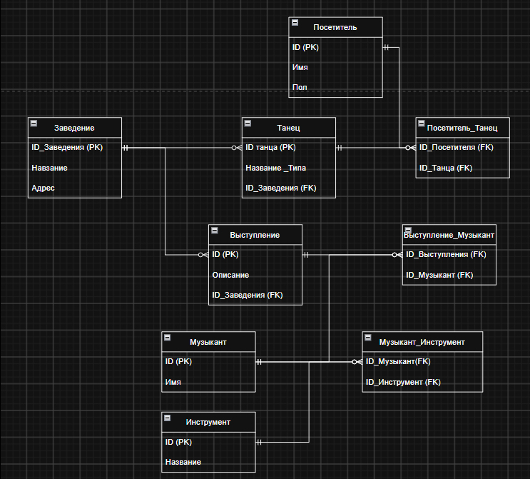
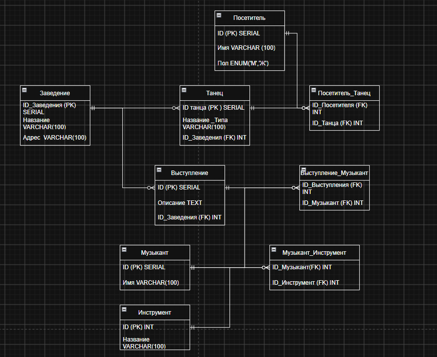

# Лабораторная работа №1

**Проектирование базы данных · PostgreSQL**

[Отчёт PDF](report/report.pdf) · [Концептуальная модель](diagrams/conceptual.drawio) · [Логическая модель](diagrams/logical.drawio) · [Физическая модель](diagrams/physical.drawio)

## Задание

На основе предложенного художественного фрагмента описать предметную область, выделить сущности, атрибуты и связи, построить модели базы данных и реализовать их в PostgreSQL с тестовыми данными. Исходный текст задания и номер варианта сохранены в отчёте.

## Предметная область

В заведении «Ужин Короля» проходит танцевальное мероприятие. Посетители участвуют в танцах, а музыканты обеспечивают сопровождение с помощью музыкальных инструментов. Заведение может проводить несколько танцев и выступлений.

## Сущности

| Сущность | Классификация в отчёте | Назначение |
| --- | --- | --- |
| Заведение | Основная статическая | Название и адрес места проведения |
| Посетитель | Основная статическая | Участник мероприятия |
| Музыкант | Основная статическая | Исполнитель |
| Инструмент | Основная статическая | Музыкальный инструмент |
| Танец | Событийная | Танцевальное действие |
| Выступление | Событийная | Музыкальное сопровождение |

## Связи

- Заведение → Танец: 1:N.
- Заведение → Выступление: 1:N.
- Танец ↔ Посетитель: M:N.
- Выступление ↔ Музыкант: M:N.
- Музыкант ↔ Инструмент: M:N.

В логической модели M:N раскрываются через таблицы `Посетитель_Танец`, `Выступление_Музыкант`, `Музыкант_Инструмент`. Всего описано девять таблиц.

## Модели

1. [Концептуальная](diagrams/conceptual.drawio): сущности, атрибуты и связи.
2. [Логическая](diagrams/logical.drawio): таблицы, PK/FK и таблицы-связки.
3. [Физическая](diagrams/physical.drawio): поля и типы для PostgreSQL.

Исходные файлы скачаны с Google Диска автора, названия приведены к единому стилю; содержимое моделей сохранено.

## Реализация и статус

В отчёте описана реализация через `psql`, приведены примеры `CREATE TABLE`, `INSERT` и `JOIN`. Полный DDL/DML-скрипт не был предоставлен, поэтому запуск всей базы из репозитория пока не воспроизводится.

В физической диаграмме пол обозначен как `ENUM('М','Ж')`: в PostgreSQL для этого необходим отдельный `CREATE TYPE`. Также в моделях отличаются названия некоторых полей; перед добавлением SQL их следует согласовать. Исходные диаграммы и PDF сохранены без исправления этих расхождений.

## Вывод

Работа показывает переход от предметной области к концептуальной, логической и физической моделям, использование PK/FK и раскрытие связей M:N.

## Подготовка к защите

ANSI-SPARC, модель «Сущность–Связь», кардинальности, ограничения целостности, первичные и внешние ключи, DDL и DML.

Структура оформления вдохновлена [примером Max Barsukov](https://github.com/maxbarsukov/itmo/tree/master/2%20%D0%B1%D0%B0%D0%B7%D1%8B%20%D0%B4%D0%B0%D0%BD%D0%BD%D1%8B%D1%85/%D0%BB%D0%B0%D0%B1%D0%BE%D1%80%D0%B0%D1%82%D0%BE%D1%80%D0%BD%D1%8B%D0%B5/lab1/); описание относится к работе автора этого репозитория.

## Предпросмотр диаграмм из отчёта

### Концептуальная

### Логическая

### Физическая

